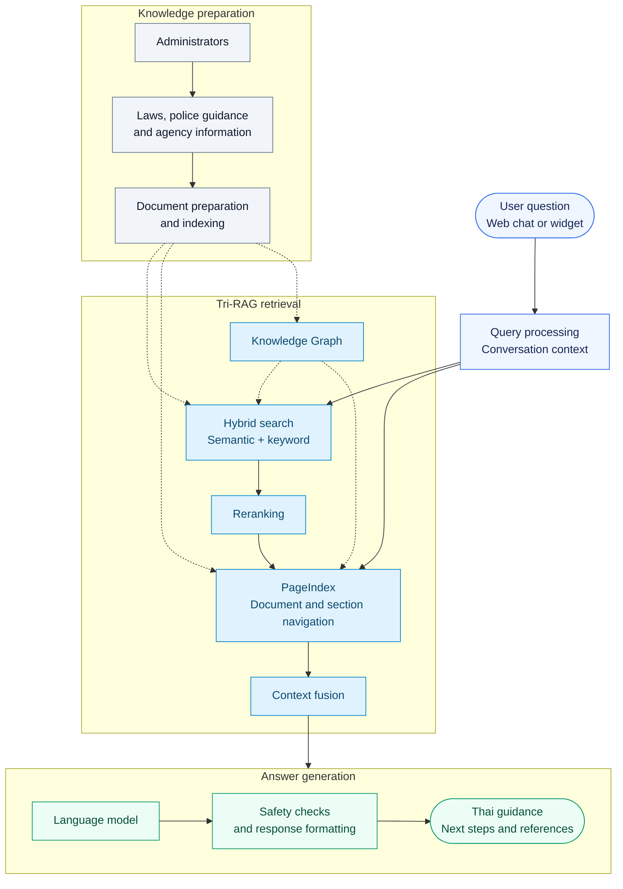

# CIBBot (ซิบบอท)

CIBBot is an AI assistant for criminal complaint guidance and legal information, developed for Thailand's Central Investigation Bureau (CIB). It helps people understand which laws may apply to an incident, where to seek help, and what documents or evidence to prepare.

The assistant retrieves information from legal documents, police guidance, and agency resources before generating an answer. This approach, known as retrieval-augmented generation (RAG), gives users practical guidance with references they can follow.

**[Visit CIBBot](https://cib.go.th/CIBbot)**

> **For international visitors:** Under CIB cybersecurity policy, the live service is restricted to access from within Thailand. Visitors abroad who would like to try CIBBot can use a VPN with a server in Thailand. The documentation in this repository is publicly accessible.

| Document | Contents |
| --- | --- |
| [Final report](CIBBot%20Final%20Report.pdf) | Research, requirements, architecture, evaluation, and user manual. |
| [Presentation slides](2026-06-18%20CIBbot%20presentation.pdf) | Project goals, retrieval architecture, services, and interface demonstrations. |

This repository contains the project documentation. Application source code and deployment configuration are not included.

## What CIBBot does

For someone facing an unfamiliar legal problem, the first difficulty is often knowing where to start. CIBBot accepts questions and incident descriptions in Thai, then explains relevant procedures in everyday language. Its public-facing functions include:

- Explaining potentially relevant offences, legal provisions, and people's rights.
- Identifying appropriate agencies and complaint channels.
- Suggesting documents and evidence to collect.
- Answering questions about fraud, online crime, and other criminal matters.
- Providing legal references and practical next steps.

The guidance is preliminary. Decisions that require professional judgment or action by an authority remain with the responsible officers.

Officers can review conversation history, add notes, and prepare AI-assisted incident reports for follow-up. Reports can be exported as PDF or DOCX files.

Administrators maintain the searchable document library, review feedback, and configure the bot's responses. The user manual and slides also show staff login, dashboards, permissions, invitations, and audit records. Operational features described in the presentation include monitoring GPU health, memory, and response times, managing GPU capacity, and scheduling daily and weekly backups.

## Architecture

The documented architecture connects the public chat interface to a retrieval and response pipeline. Administrators maintain the knowledge used by that pipeline, while the application carries the user's question and conversation context through each stage.

Solid arrows show the processing flow. Dotted arrows supply indexed knowledge and relationships. The diagram summarizes the logical design described in the report and slides.

### How Tri-RAG retrieves evidence

The report calls the combined retrieval approach **Tri-RAG**. Its three components address different parts of a legal question:

| Component | Role |
| --- | --- |
| Hybrid RAG | Finds relevant passages through semantic vector search and BM25 keyword search, then uses a cross-encoder reranker to prioritize the results. |
| PageIndex | Follows the structure of source documents to identify relevant pages and sections and prepare context for the response. |
| Knowledge Graph | Connects laws, offences, cases, agencies, procedures, and documents to support both hybrid retrieval and PageIndex. |

The query can reach both hybrid retrieval and PageIndex. Retrieved passages are ranked, examined in their document context, and combined before being passed to the language model. The presentation also describes a separate Law Section Index for direct lookup of statutory provisions.

### From evidence to an answer

The language model uses the selected material and conversation context to explain the relevant law or procedure. The presentation calls this component "CIB Advisor LLM"; it does not specify a deployed model version.

Before delivery, a Safety Layer uses rules and LLM-based review to check legal references, appropriateness, agency remit, and sensitive information. Response formatting then presents the guidance, next steps, and references through the chat interface. Where an incident needs more detail, the conversation can include follow-up questions.

### Maintaining the knowledge base

Administrators organize and update the source documents, which include Thai criminal and procedural laws, related legislation, Royal Thai Police orders, agency information, and complaint procedures.

Document preparation covers cleansing, normalization, indexing, and reindexing. Vector embeddings support semantic search, while extracted legal entities and relationships populate the Knowledge Graph. Source and version management keeps material traceable; feedback and conversation review help identify missing or outdated information.

## Reported project evaluation

The final report compares a baseline LLM + Hybrid RAG system with CIB Advisor using LLM + Tri-RAG. Both were evaluated using the same questions and criteria.

| Evaluation dimension | Baseline | CIB Advisor |
| --- | ---: | ---: |
| Answer correctness | 89.4% | 91.7% |
| Document retrieval | 92.0% | 96.6% |
| SOP / procedure compliance | 92.0% | 92.0% |
| Reported overall score | 91.1% | 93.4% |

The evaluation used 70 answer-correctness questions, 88 retrieval questions, and 50 procedure-compliance questions. AI scored responses against reference answers, and developers spot-checked at least 10%. These figures describe the project evaluation and should be read in that context. The method and results appear in section 4.4.2 of the [final report](CIBBot%20Final%20Report.pdf), PDF pages 161-162.

## Project status

The report documents a developed and tested prototype and concludes that it is ready for deployment. The presentation records the service during testing and demonstrates its interfaces.

Future recommendations include more mobile and messaging channels, Thai voice input, automated ingestion of official documents, and further improvements to models and retrieval. These remain roadmap items in the project materials.

## Sources

- [Final report](CIBBot%20Final%20Report.pdf): executive summary; section 4.2 for architecture and functional requirements; section 4.4.2 for evaluation; and the user manual.
- [Presentation slides](2026-06-18%20CIBbot%20presentation.pdf): pages 7 and 12 for public services, 10-11 for retrieval and architecture, 13 for administration and operations, and 15-28 for interface demonstrations.

Page references use physical PDF pages. The international-access note is guidance supplied by the repository owner.
