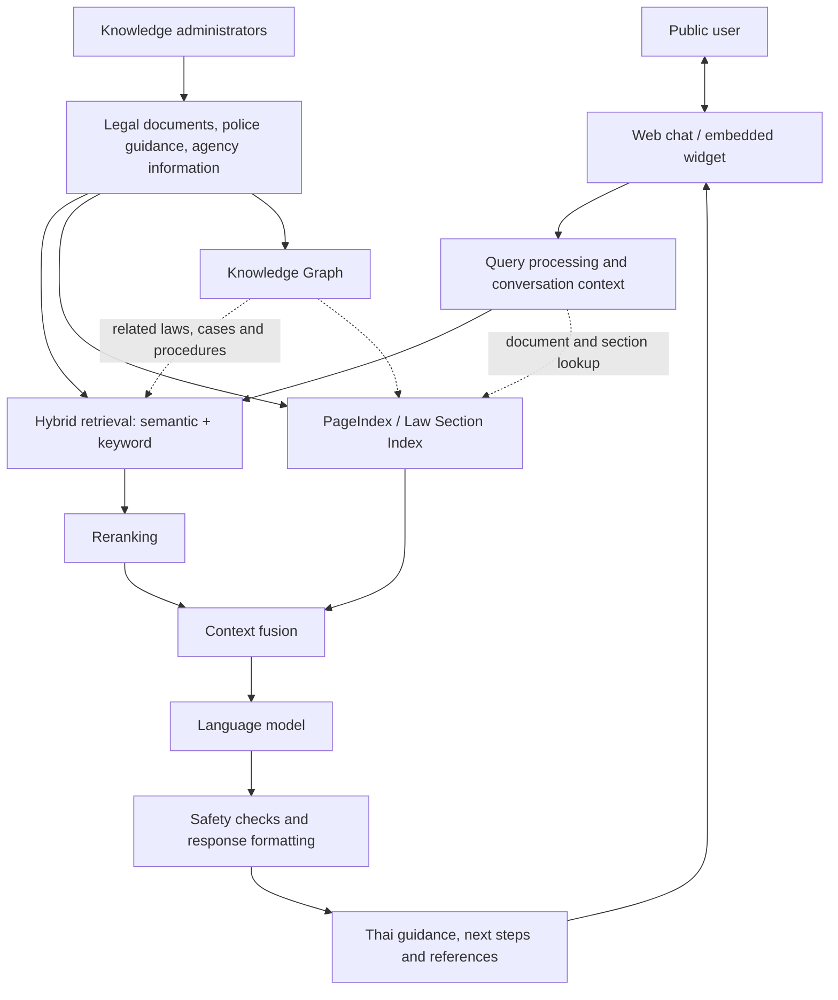

# CIBBot (ซิบบอท)

**An AI-powered assistant for criminal complaint guidance and legal information in Thailand.**

CIBBot is a project for Thailand's Central Investigation Bureau (CIB). It helps people understand an incident, find the appropriate complaint channel, prepare documents and evidence, and learn about relevant laws and their rights. It combines a large language model with retrieval from legal documents, police guidance, and agency information to produce conversational answers with references.

**[Visit CIBBot](https://cib.go.th/CIBbot)**

> **For international visitors:** Under CIB cybersecurity policy, the live service is restricted to access from within Thailand. Visitors outside Thailand who would like to try CIBBot can use a VPN with a server located in Thailand. The documentation in this GitHub repository is publicly accessible.

| Project document | Contents |
| --- | --- |
| [Final report](CIBBot%20Final%20Report.pdf) | Research, requirements, architecture, evaluation, and user documentation. |
| [Presentation slides](2026-06-18%20CIBbot%20presentation.pdf) | Project goals, retrieval architecture, public services, and interface demonstrations. |

This repository publishes the project documentation. Application source code and deployment configuration are not included.

## Purpose and users

People seeking help may be unsure whether an incident is a criminal matter, which authority to contact, or what evidence to collect. CIBBot is intended to make that first step easier through plain-language, Thai-language interaction, while reducing repetitive enquiries handled by staff.

The project serves three groups:

- **Members of the public:** ask legal and procedural questions, describe incidents, and receive preliminary guidance.
- **Officers:** review conversations and AI-assisted case summaries to support follow-up.
- **Administrators:** maintain the knowledge base, manage access, review feedback, and configure the service.

The system provides preliminary information. Questions requiring professional judgment or action by an authority remain matters for the responsible officers.

## Main capabilities

### Public assistance

- Explain potentially relevant offences, legal provisions, and criminal complaint procedures.
- Help users identify appropriate agencies and reporting channels.
- Suggest documents and evidence to prepare.
- Answer scenario-based questions about fraud, online crime, and other criminal matters.
- Present relevant legal references and practical next steps in understandable language.

### Staff and administration

The report's user manual and the presentation demonstrate web chat, an embeddable chat widget, staff login, dashboards, a searchable document knowledge base, and conversation history. They also describe:

- AI-assisted preliminary case reports, with PDF and DOCX export.
- Knowledge-document organization and maintenance.
- User feedback review and bot-personality settings.
- Staff permissions, invitations, and audit records.

The presentation also describes Grafana monitoring of GPU health, memory, and response times; GPU capacity management; and scheduled daily and weekly backups.

## Architecture

The report describes a layered design:

| Layer | Responsibility |
| --- | --- |
| **User interface** | Public chat and widget, plus officer and administrator interfaces. |
| **Application** | Query processing, conversation management, service workflows, and access control. |
| **Knowledge and AI** | Retrieve legal evidence, rank and combine results, and generate a contextual response. |
| **Data and security** | Store application and knowledge data; support permissions, consent, and auditability. |

The following diagram is a simplified synthesis of the report and presentation, showing the logical responsibilities of the main components.

### Retrieval and the Tri-RAG design

The report calls its combined retrieval approach **Tri-RAG**:

1. **Hybrid RAG:** combines semantic similarity with keyword retrieval. The report's design includes dense vector retrieval and sparse BM25 retrieval, followed by cross-encoder reranking.
2. **PageIndex:** uses document structure and source locations to find and verify relevant passages. The presentation also identifies a **Law Section Index** for direct lookup of legal sections.
3. **Knowledge Graph:** connects laws, offences, cases, agencies, procedures, and related documents. It enriches both hybrid retrieval and document navigation.

A **Safety Layer** is described before the final response. It uses rules and LLM-based review to check legal references, appropriateness, agency remit, and sensitive information, then adjusts the response before delivery.

### Request flow

1. A user asks a question or describes an incident.
2. The application processes the query together with the conversation context.
3. Retrieval gathers candidate passages from the legal knowledge base, using semantic, keyword, document-structure, and relationship information as appropriate.
4. Reranking prioritizes relevant evidence, and context fusion combines it for the language model.
5. The model produces an understandable response grounded in the selected material.
6. Safety checks and response formatting prepare the guidance, references, and next steps for the user.

The presentation labels the generation component **“CIB Advisor LLM.”** This is an architectural label, not a confirmed underlying model or model version.

### Knowledge management

Administrators maintain the source documents used by the assistant. The documented workflow covers document preparation, cleansing, normalization, indexing, and reindexing. Vector embeddings support semantic search, while extracted legal entities and relationships support the Knowledge Graph. Source/version management, feedback, and conversation review help maintain the knowledge base.

The knowledge sources include Thai criminal and procedural laws, related legislation, Royal Thai Police orders and guidance, agency information, and complaint procedures. Keeping those sources current is part of operating the system.

### Named technologies and integration points

| Component | What the documents establish |
| --- | --- |
| **PostgreSQL** | Named as the main database in the report's software-interface design. |
| **Milvus** | Named as the vector database in that design. |
| **Grafana** | Named in the presentation for monitoring GPU health, memory, and response times. |
| **CIB Internal API** | A documented integration point for existing legal and knowledge systems. |
| **Facebook Messenger API** | A documented integration point for handing conversations to officers. |
| **LLM, embeddings, and reranker** | Described as AI components; this repository does not identify a reproducible deployed model configuration. |

Mobile applications, authorized external APIs, voice input, and additional messaging channels appear in the design or roadmap. Their inclusion here should not be read as confirmation that every channel is currently available.

## Access, privacy, and human oversight

The documentation specifies differentiated public, officer, and administrator roles, consent notices, access control, and audit logging. Its requirements call for processing sensitive data within agency infrastructure and removing identifying information before reusing conversation-derived knowledge. Officers review AI-generated preliminary reports and handle cases requiring professional judgment.

## Reported project evaluation

The final report compares a baseline **LLM + Hybrid RAG** system with **CIB Advisor using LLM + Tri-RAG**, using the same questions and criteria.

| Evaluation dimension | Baseline | CIB Advisor |
| --- | ---: | ---: |
| Answer correctness | 89.4% | 91.7% |
| Document retrieval | 92.0% | 96.6% |
| SOP / procedure compliance | 92.0% | 92.0% |
| Reported overall score | 91.1% | 93.4% |

The evaluation used 70 answer-correctness questions, 88 retrieval questions, and 50 procedure-compliance questions. Scores were produced by AI against reference answers, with developers spot-checking at least 10%. These are the report's project-evaluation results, not an independent measurement of the live website. See **section 4.4.2, PDF pages 161–162**.

## Project status and sources

The materials document a developed and tested prototype, with interface demonstrations, a user manual, and project evaluation. The report concludes that the system is ready for deployment; the presentation records its testing stage. Future recommendations include additional mobile and messaging channels, Thai voice input, automated official-document ingestion, and further model and retrieval improvements.

The architecture and feature descriptions above are drawn from:

- **Final report:** executive summary; section **4.2** (architecture, system design, and functional requirements); and the user manual. The database and integration names appear in **4.2.3.1**.
- **Presentation:** pages **7 and 12** (public services), **10–11** (retrieval and architecture), **13** (administration and operations), and **15–28** (interface demonstrations).

The international-access note above is project-owner guidance. Other feature and architecture descriptions are based on the linked project documents. Page numbers refer to physical PDF pages. Read the [final report](CIBBot%20Final%20Report.pdf) and [slides](2026-06-18%20CIBbot%20presentation.pdf) for the underlying requirements, diagrams, and evaluation context.
