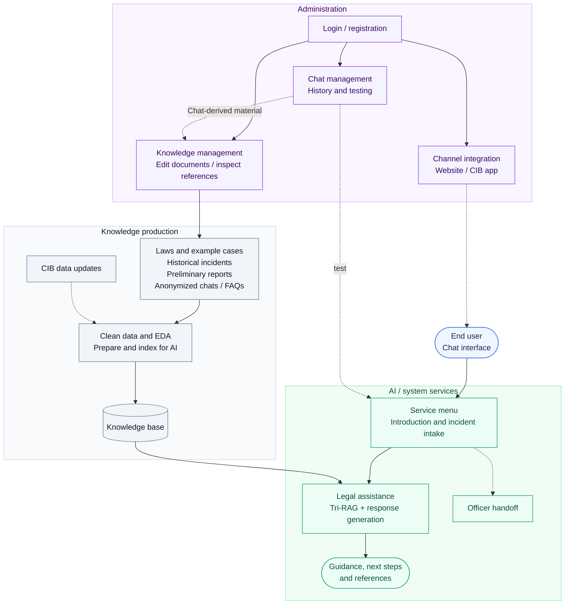
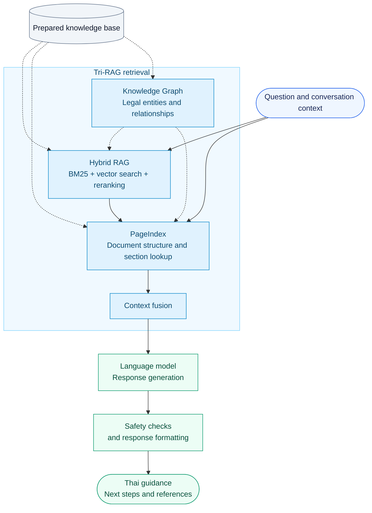

# CIBBot (ซิบบอท)

CIBBot is an AI assistant for criminal complaint guidance and legal information, developed for Thailand's Central Investigation Bureau (CIB). It helps people understand which laws may apply to an incident, where to seek help, and what documents or evidence to prepare.

The assistant retrieves information from legal documents, police guidance, and agency resources before generating an answer. This approach, known as retrieval-augmented generation (RAG), gives users practical guidance with references they can follow.

**[Visit CIBBot](https://cib.go.th/CIBbot)**

> **For international visitors:** Under CIB cybersecurity policy, the live service is restricted to access from within Thailand. Visitors abroad who would like to try CIBBot can use a VPN with a server in Thailand. The documentation in this repository is publicly accessible.

| Document | Contents |
| --- | --- |
| [Final report](CIBBot%20Final%20Report.pdf) | Research, requirements, architecture, evaluation, and user manual. |
| [Presentation slides](2026-06-18%20CIBbot%20presentation.pdf) | Project goals, retrieval architecture, services, and interface demonstrations. |

This repository contains the project documentation. Application source code and deployment configuration are not included.

## What CIBBot does

For someone facing an unfamiliar legal problem, the first difficulty is often knowing where to start. CIBBot accepts questions and incident descriptions in Thai, then explains relevant procedures in everyday language. Its public-facing functions include:

- Explaining potentially relevant offences, legal provisions, and people's rights.
- Identifying appropriate agencies and complaint channels.
- Suggesting documents and evidence to collect.
- Answering questions about fraud, online crime, and other criminal matters.
- Providing legal references and practical next steps.

The guidance is preliminary. Decisions that require professional judgment or action by an authority remain with the responsible officers.

Officers can review conversation history, add notes, and prepare AI-assisted incident reports for follow-up. Reports can be exported as PDF or DOCX files.

Administrators maintain the searchable document library, review feedback, and configure the bot's responses. The user manual and slides also show staff login, dashboards, permissions, invitations, and audit records. Operational features described in the presentation include monitoring GPU health, memory, and response times, managing GPU capacity, and scheduling daily and weekly backups.

## Architecture

The system framework follows **Figure 33 in the final report** (section 4.2.3.2, printed page 129 / PDF page 131). It brings together the public chat service, administration, knowledge management, and data preparation. The AI answering pipeline sits within this wider framework.

### System framework

The overview separates the conversation workflow from the work needed to maintain its knowledge. Web/widget chat and staff tools are demonstrated in the user manual. CIB app integration, voice input, automatic agency updates, and officer handoff are design requirements or extension points in the report.

Solid arrows show the main workflow and knowledge inputs. Dotted arrows show channel setup, testing, conversation-derived material, agency updates, and the handoff route. Text and voice are the report's specified input modes; the overview groups them under the chat interface.

| Area | Responsibilities in the report |
| --- | --- |
| User access and integration | Provide a chat interface through the website or external application, with channel configuration managed by administrators. |
| Chat management | Maintain conversation sessions and history; provide a testing interface with access to processing context and cited sources. |
| Knowledge management | Add, edit, delete, and version documents; inspect documents referenced in conversations; trigger reindexing and incorporate agency updates. |
| AI service workflow | Introduce the service, offer a menu, ask for basic and incident information, generate guidance, or route the user to an officer. |
| Knowledge production | Collect source material, clean and analyze it, and prepare searchable knowledge for the AI system. |

Officers can use conversation history to prepare preliminary reports. Reusable FAQ material from those conversations enters knowledge preparation only after identifying information has been removed.

### Knowledge production

Figure 33 identifies four source groups: anonymized conversations used for FAQs, legal documents and example cases, historical incident reports, and preliminary investigation reports. Administrators maintain these materials alongside police guidance and agency information.

The preparation flow follows Figure 33 and the report's knowledge-base, data-preparation, and AI requirements:

1. Collect documents, reports, and approved conversation-derived material.
2. Clean and normalize the data, then perform exploratory data analysis (EDA) and preparation for AI use.
3. Create vector embeddings, search indexes, and legal entity relationships.
4. Maintain the knowledge base through document updates, versioning, and reindexing.

This flow makes the relationship between source collection, prepared data, and the knowledge base explicit.

### Tri-RAG and response generation

The legal-assistance component in the overview expands into the pipeline below. It combines the report's Tri-RAG design (Figure 39) with the retrieval and response stages in Figure 30 and presentation pages 10-11.

Solid arrows carry the query and response through the pipeline. Dotted arrows supply indexed knowledge and legal relationships.

| Component | Role |
| --- | --- |
| Hybrid RAG | Combines BM25 keyword search with semantic vector search, then reranks passages by relevance. |
| PageIndex | Uses document structure to identify relevant pages and sections and develop the context for an answer. |
| Knowledge Graph | Connects laws, offences, cases, agencies, procedures, and documents to support both Hybrid RAG and PageIndex. |
| Context fusion | Combines the selected evidence for the language model. |
| Response generation | Produces Thai guidance, applies checks, and formats next steps and references for the user. |

The question and conversation context can reach both Hybrid RAG and PageIndex. The Knowledge Graph supports both paths. The presentation also identifies a separate Law Section Index for direct lookup of statutory provisions.

The language model, labeled "CIB Advisor LLM" in the presentation, uses the selected evidence to explain the relevant law or procedure. A Safety Layer checks legal references, appropriateness, agency remit, and sensitive information before the response is delivered. Follow-up questions collect missing incident details when needed.

## Reported project evaluation

The final report compares a baseline LLM + Hybrid RAG system with CIB Advisor using LLM + Tri-RAG. Both were evaluated using the same questions and criteria.

| Evaluation dimension | Baseline | CIB Advisor |
| --- | ---: | ---: |
| Answer correctness | 89.4% | 91.7% |
| Document retrieval | 92.0% | 96.6% |
| SOP / procedure compliance | 92.0% | 92.0% |
| Reported overall score | 91.1% | 93.4% |

The evaluation used 70 answer-correctness questions, 88 retrieval questions, and 50 procedure-compliance questions. AI scored responses against reference answers, and developers spot-checked at least 10%. These figures describe the project evaluation and should be read in that context. The method and results appear in section 4.4.2 of the [final report](CIBBot%20Final%20Report.pdf), PDF pages 161-162.

## Project status

The report documents a developed and tested prototype and concludes that it is ready for deployment. The presentation records the service during testing and demonstrates its interfaces.

Future recommendations include more mobile and messaging channels, Thai voice input, automated ingestion of official documents, and further improvements to models and retrieval. These remain roadmap items in the project materials.

## Sources

- [Final report](CIBBot%20Final%20Report.pdf): executive summary; section 4.2 for architecture and functional requirements; section 4.4.2 for evaluation; and the user manual.
- [Presentation slides](2026-06-18%20CIBbot%20presentation.pdf): pages 7 and 12 for public services, 10-11 for retrieval and architecture, 13 for administration and operations, and 15-28 for interface demonstrations.

Page references use physical PDF pages. The international-access note is guidance supplied by the repository owner.
